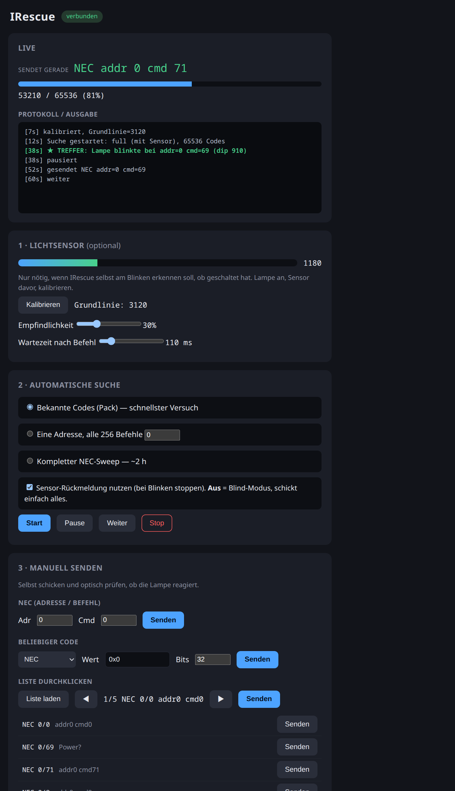

**English** · [Deutsch](README.de.md)

# IRescue

Lost the infrared remote for your lamp, LED strip or fan? IRescue is an
ESP32-based tool that **finds the lost codes by brute force**, and later
**learns remotes and shares their codes as packs**, so others with the same
device can just load a pack.

> Status: early prototype. Firmware builds and flashes; needs hardware testing.

<p align="center"></p>

## Modes

- **Automatic search** with the light sensor as an oracle — stops on the blink.
- **Blind mode** — no sensor needed: just fire every code (uncheck "use sensor
  feedback"), watch the lamp yourself.
- **Manual send** — type any NEC address/command, or any protocol + hex value,
  or step through the code list one by one and check by eye.
- **Live view** — see the code being sent right now, a progress bar, and a
  running log of everything that happens (sent, received, hits).
- **Learn** a remote (with an IR receiver) and save codes as device packs.

## How it works

1. **Known codes first:** replay code lists from public databases
   (Flipper-IRDB, IRDB, LIRC) that are likely to match (LED lamps, LED strips).
2. **Protocol sweep:** systematically send all combinations of the most common
   protocol (NEC: 256 addresses × 256 commands ≈ 2 hours).
3. **Automatic detection:** a light sensor watches the lamp. Many lamps briefly
   blink when they accept a command. IRescue notices this, narrows it down to
   the exact code and logs it.
4. **Learn & share (planned):** an IR receiver records existing remotes; the
   result is saved as a pack in a Flipper-compatible `.ir` format.

## Hardware (prototype)

| Part | Purpose |
|---|---|
| ESP32 dev board | Control, 38 kHz carrier via the RMT peripheral |
| IR LED 940 nm (e.g. TSAL6200) + NPN transistor/MOSFET + resistor | Sending |
| Light sensor (e.g. TEMT6000 or phototransistor) | Detects the lamp blinking |
| IR receiver TSOP38238 / VS1838B (optional) | Learning remotes |

## Get it running (no toolchain needed)

1. **Flash from the browser:** open the [**Web Flasher**](https://technikweber.github.io/IRescue/)
   in Chrome/Edge, plug in the ESP32 via USB, click install. No IDE, no install.
   Other ways (esptool, build it yourself): [docs/FLASHEN.md](docs/FLASHEN.md).
2. **Wire it up:** [docs/HARDWARE.md](docs/HARDWARE.md) · parts list:
   [docs/EINKAUFSLISTE.md](docs/EINKAUFSLISTE.md).
3. **Use it:** connect to the **open** WiFi `IRescue-XXXX` — the UI opens by
   itself (captive portal), otherwise `http://192.168.4.1/`. Calibrate the light
   sensor, then start the search.

Prebuilt binaries live in [`webflasher/firmware/`](webflasher/firmware/) and are
rebuilt on every push by CI, so anyone can flash, compile and modify.

## Repository layout

```
firmware/       PlatformIO project (ESP32, IRremoteESP8266, async web UI)
  src/          firmware source (engine, oracle, packs, web)
  data/         web UI served from LittleFS (+ candidates.json)
webflasher/     browser flasher (GitHub Pages) + prebuilt binaries
packs/          device packs (.ir, Flipper-compatible), one per remote
tools/          import_db.py: build a candidate list from a code database
docs/           concept, hardware, shopping list, flashing & build guides
```

## Databases & licenses

Flipper-IRDB is **CC0** and can be embedded/extended freely — it is the default
source. `irdb` and LIRC have restrictive/copyleft licenses and are only used
locally. Details and download locations: [packs/README.md](packs/README.md).

See [docs/KONZEPT.md](docs/KONZEPT.md) (German) for the detailed concept.

## License

[MIT](LICENSE).
