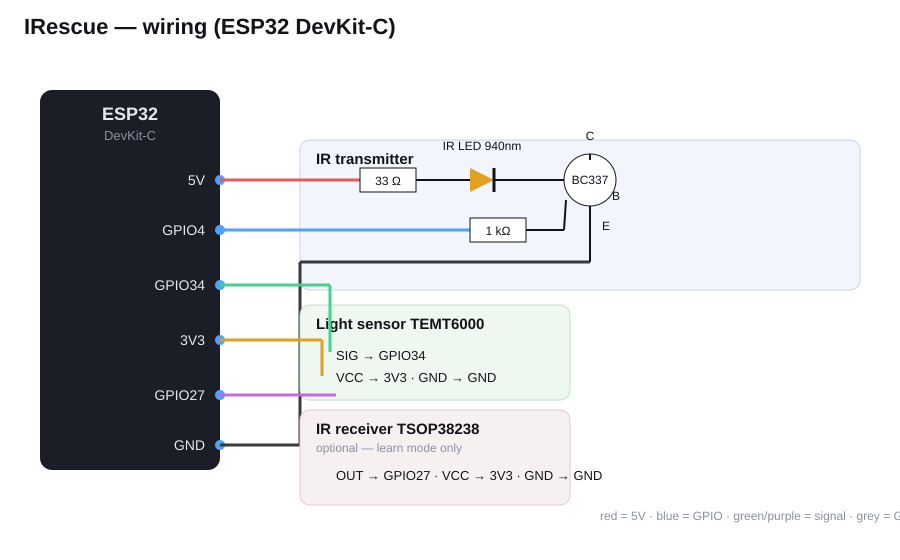

# Hardware & Verdrahtung

Einkaufsliste: [EINKAUFSLISTE.md](EINKAUFSLISTE.md).



## Verdrahtung als Text

```
IR-Sender:
  ESP32 5V ───[ 33 Ω ]─── Anode IR-LED
  Kathode IR-LED ───────── Kollektor  (BC337)
  ESP32 GPIO4 ──[ 1 kΩ ]── Basis      (BC337)
  Emitter (BC337) ──────── ESP32 GND

Lichtsensor (TEMT6000):
  VCC ── ESP32 3V3
  GND ── ESP32 GND
  SIG ── ESP32 GPIO34      (ADC1, Eingang)

IR-Empfänger (TSOP38238, optional, nur Anlernen):
  VCC ── ESP32 3V3
  GND ── ESP32 GND
  OUT ── ESP32 GPIO27
```

## Warum so?

- **Transistor statt LED direkt am Pin:** Ein GPIO liefert nur ~20 mA. Über den
  BC337 fließen mit dem 33-Ω-Widerstand ~110 mA gepulst durch die LED → deutlich
  mehr Reichweite. Der 1-kΩ-Widerstand begrenzt den Basisstrom.
- **GPIO34 für den Sensor:** Das ist ein ADC1-Pin. ADC2-Pins sind mit aktivem
  WLAN gesperrt — und WLAN läuft hier immer (Accesspoint).
- **Alternativer Transistor:** Logic-Level-MOSFET (z. B. 2N7000), dann Gate statt
  Basis, der 1-kΩ-Widerstand kann bleiben.

## Pins ändern

Alle Pins stehen in [`firmware/src/config.h`](../firmware/src/config.h):
`PIN_IR_SEND`, `PIN_LIGHT`, `PIN_IR_RECV`.
